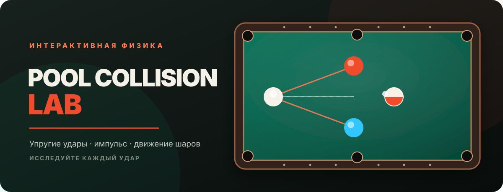

<div align="center">
  

  <h1>Pool Collision Lab</h1>
  <p><strong>Интерактивная лаборатория бильярдной физики</strong></p>
  <p>Исследуйте, как точка прицеливания, масса и тип удара меняют движение шаров.</p>

  <p>
    
    
    
  </p>
</div>

## Запуск

Откройте **[`index.html`](index.html)** в современном браузере. Сборка, сервер и установка зависимостей не нужны.

## Возможности

| Инструмент | Что можно изучить |
| --- | --- |
| **Столкновения** | Сравнить упругий и абсолютно неупругий удар |
| **Параметры шаров** | Менять скорость, массы и смещение точки прицеливания |
| **Интерактивный стол** | Перемещать прицел, менять масштаб и двигать симуляцию по шагам |
| **Разбой** | Наблюдать за ударом по треугольнику из 15 шаров |
| **Показания модели** | Следить за импульсом и скоростями до и после контакта |

## Публикация сайта

Чтобы разместить сайт через GitHub Pages:

1. Откройте **Settings → Pages** в репозитории.
2. В разделе **Build and deployment** выберите **Deploy from a branch**.
3. Укажите ветку `main` и папку `/ (root)`, затем нажмите **Save**.

После публикации GitHub покажет адрес сайта в разделе Pages.

## Устройство проекта

```text
├── assets/
│   └── cover.svg     # обложка репозитория
├── index.html        # сайт, стили и симуляция
├── README.md         # описание проекта
└── .gitignore
```

Сайт написан на HTML, CSS и JavaScript. Стол рисуется через Canvas API; внешние библиотеки и сетевые запросы не используются.

